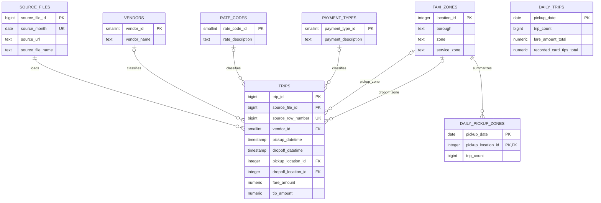

# NYC Yellow Taxi Trip Analytics

This local project uses ClickHouse as the trip-level store and analytics
engine, PostgreSQL for two dashboard-ready summaries, a single Jupyter
benchmark notebook, and three standalone Plotly charts. September 2026 is the
demonstration month; change the month argument or `NYC_TAXI_MONTH` to use
another TLC monthly file.

## Run sequence

Install Python 3.12 and Docker Desktop (or Docker with the Compose plugin),
then open a terminal in the project folder. Copy the supplied local settings
from `.env.example` to `.env`, create the virtual environment, and install the
dependencies.

On macOS or Linux:

```bash
cp -n .env.example .env
python3.12 -m venv .venv
source .venv/bin/activate
python -m pip install -r requirements.txt
```

On Windows PowerShell:

```powershell
if (-not (Test-Path .env)) { Copy-Item .env.example .env }
py -3.12 -m venv .venv
.venv\Scripts\python.exe -m pip install -r requirements.txt
```

With Docker running, run the following commands. On Windows, use
`.venv\Scripts\python.exe` in place of `python` for each Python command.

```bash
docker compose up -d
python load_month.py --month 2026-08
python load_month.py --month 2026-09
python load_postgres.py
python plot_charts.py --month 2026-09
```

If a TLC download on macOS fails with `CERTIFICATE_VERIFY_FAILED`, run the
following from the activated virtual environment, then retry the load. This
uses the installed certificate bundle for HTTPS verification.

```bash
export SSL_CERT_FILE="$(python -m certifi)"
```

The August load supplies the six preceding calendar days needed for a
seven-calendar-day rolling average at the start of September. Load only the
requested month if that leading context is not needed. To backfill another
month, run `load_month.py --month YYYY-MM` for each month; each load is
independently rerunnable.

Open [nyc_taxi_benchmarks.ipynb](./nyc_taxi_benchmarks.ipynb) in VS Code or
Jupyter, select the project `.venv` kernel, set `MONTH` or `NYC_TAXI_MONTH`,
and run all cells. The notebook requires the ClickHouse service and a cached or
downloadable official source Parquet file.

## Source data and loader behavior

- Official Yellow Taxi Parquet:
  `https://d37ci6vzurychx.cloudfront.net/trip-data/yellow_tripdata_YYYY-MM.parquet`
- Official Taxi Zone Lookup CSV:
  `https://d37ci6vzurychx.cloudfront.net/misc/taxi_zone_lookup.csv`
- TLC Yellow Trip Record Data Dictionary:
  `https://www.nyc.gov/assets/tlc/downloads/pdf/data_dictionary_trip_records_yellow.pdf`

[trip_fields.py](./trip_fields.py) maps vendor, timestamps, location IDs,
passenger count, rate/payment codes, distance, fare, tip, tolls, taxes and
surcharges, `cbd_congestion_fee`, `request_source`, and total amount. The loader
accepts both `Airport_fee` and `airport_fee`. Pickup/drop-off timestamps and
zone IDs are required; missing optional columns in a source month become NULL
and are reported. This accommodates differences in TLC schemas over time.

[load_month.py](./load_month.py) downloads through a temporary file into the
ignored `.cache/tlc/` directory, reads 65,536-row PyArrow batches, inserts into
a unique ClickHouse staging table, and checks both staged and read row counts
against Parquet metadata before replacing the target source-month partition.
A failed stage does not replace the previously published partition. The
`source_month` is the Parquet file month; `source_file` retains the source
filename. No source rows are rejected by the current mapping.

TLC pickup and drop-off timestamps are NYC-local wall-clock values. ClickHouse
stores them as `DateTime64(6, 'America/New_York')`; daily query dates and
hour-of-day calculations use that timezone. Records whose pickup timestamps
fall outside their file month remain in the trip table. Demand calculations
use explicit local pickup date boundaries. Invalid durations remain stored
and count toward demand, but duration metrics include only trips with both
timestamps and `0 < dropoff - pickup <= 24 hours`.

The official lookup is loaded into ClickHouse `taxi_zones` and joined with a
left join, so NULL or unmatched IDs remain in demand results as unknown. In
PostgreSQL daily zone summaries, NULL pickup IDs are represented by location
ID `0` and an explicit unknown reference row. TLC `tip_amount` records
credit-card tips; cash tips are not reported in that field. Tip metrics are
therefore labeled **recorded card tips**, not all tips.

## September 2026 execution evidence

The local source Parquet metadata and ClickHouse staging checks agreed:

| Source month | Parquet rows | Read/accepted | Rejected | Published in ClickHouse |
|---|---:|---:|---:|---:|
| 2026-08 (rolling-window context) | 3,336,716 | 3,336,716 | 0 | 3,336,716 |
| 2026-09 (demonstration) | 3,876,044 | 3,876,044 | 0 | 3,876,044 |

The September load completed in 44.85 seconds; the August load in 43.23
seconds. The loader command printed metadata-matching rows and zero rejects.
September was loaded twice: the initial load took 44.85 seconds and its rerun
took 46.01 seconds. The final partition count remained 3,876,044, matching
Parquet metadata.

## ClickHouse analytics SQL

Select the configured ClickHouse database in DBeaver and run any SQL file
independently. Date literals in each file are editable. All five queries were
executed against the local ClickHouse instance after the September 2026 load:

1. [01_demand_by_zone_and_hour.sql](./sql/analytics/01_demand_by_zone_and_hour.sql) —
   zone lookup `JOIN`; demand by pickup zone and NYC-local hour (5,807 groups).
2. [02_top_pickup_zones.sql](./sql/analytics/02_top_pickup_zones.sql) —
   CTE with deterministic `ROW_NUMBER()` and tie-preserving `RANK()` (20 rows).
3. [03_fares_tips_and_duration.sql](./sql/analytics/03_fares_tips_and_duration.sql) —
   fare, recorded card tips, card-tip rate, and eligible duration by borough
   (8 borough/unknown groups).
4. [04_rolling_trip_demand.sql](./sql/analytics/04_rolling_trip_demand.sql) —
   complete calendar and trailing seven-calendar-day average (30 September
   dates; the preceding six dates come from August).
5. [05_sql_pandas_comparison.sql](./sql/analytics/05_sql_pandas_comparison.sql) —
   daily pickup counts by zone, identical to the notebook comparison (7,270
   groups).

## PostgreSQL summaries and preserved 3NF schema

The regular workflow does not load trip-level rows into PostgreSQL.
[load_postgres.py](./load_postgres.py) runs daily-trip and daily-zone summary
queries in ClickHouse, then replaces
`analytics.daily_trips` and `analytics.daily_pickup_zones` together in one
PostgreSQL transaction. The transaction seeds/updates taxi-zone descriptions
needed for the zone foreign key. It checks row counts and total trips before
committing. Rerunning the publisher is safe and leaves the same summary
counts. The summaries represent all source months currently loaded in
ClickHouse, not only September. The existing January 2024 partition was
preserved, so the 10,177,384-trip verification total includes January 2024,
August 2026, and September 2026.

The normalized schema remains in
[sql/postgres/schema.sql](./sql/postgres/schema.sql). If an instructor requires
3NF trip rows with data, use the separate, explicitly optional sample command:

```bash
.venv/bin/python load_postgres_sample.py --month 2026-09 --sample-rows 100000
```

This loads only the first 100,000 rows of the selected source month into the
normalized PostgreSQL model; it does not refresh or overwrite the published
summary tables. The ordinary workflow does not run this sample loader.

The ER diagram shows the normalized trip model and the separate aggregate
grains. Lookup descriptions are stored once in reference tables; trips carry
only nullable code/zone foreign keys. A warehouse identity `trip_id` is used
because TLC does not provide a dependable unique trip key. The source-file
plus row-number pair identifies records belonging to the replaceable file.



`analytics.daily_trips` has one row per pickup date, keyed by `pickup_date`.
`analytics.daily_pickup_zones` has one row per pickup date and pickup location,
keyed by `(pickup_date, pickup_location_id)`. Money in the normalized schema
uses `NUMERIC`; source money is not downcast in the Pandas benchmark. Missing
codes remain NULL; unknown non-NULL codes and unmatched zone IDs receive
explicit reference descriptions.

## Notebook benchmark results

The executed notebook is
[nyc_taxi_benchmarks.ipynb](./nyc_taxi_benchmarks.ipynb). It creates the
equivalent CSV from the same 12 September columns and 3,876,044 rows, reads
both formats three times, verifies a 65,536-row chunked CSV scan, measures
Pandas memory on 250,000 rows, and compares sorted ClickHouse/Pandas
daily-zone results exactly.

| Read path | File size (decimal MB) | Median read time | Compression |
|---|---:|---:|---|
| Parquet / PyArrow batches | 67.37 | 0.067 s | ZSTD |
| CSV / Pandas chunks | 220.50 | 6.639 s | none |

The OS file cache was not cleared between repeated reads. CSV uses explicit
nullable integer, float, string, and timestamp parsing rather than type
inference. The chunked CSV pass processed all 3,876,044 rows.

| Pandas sample memory | Before | After | Saved |
|---|---:|---:|---:|
| 250,000 rows, `memory_usage(deep=True)` | 38.000 MB | 13.001 MB | 65.8% |

`VendorID`, `RatecodeID`, `payment_type`, and `store_and_fwd_flag` became
categories; `passenger_count` was narrowed to nullable `Int8`, and pickup/drop
off IDs to nullable `Int16` after range and missing-value checks. `trip_distance`
and all monetary fields remained `float64`; monetary values were unchanged.

The SQL and Pandas paths used the same September source file, local date
interval, and NULL-zone rule. Both returned 7,270 sorted date/zone groups;
the exact equality assertion passed with zero mismatches.

| Timer | Median |
|---|---:|
| ClickHouse SQL + result transfer/decoding | 0.075 s |
| Pandas Parquet batch read | 0.052 s |
| Pandas conversion/filter/group aggregation | 0.979 s |
| Pandas end-to-end read + aggregation | 1.030 s |

ClickHouse wall time includes server work and returned-result transfer. Pandas
read time measures PyArrow batch iteration; its aggregation timer includes
batch-to-Pandas conversion, local date filtering, and grouping. The Pandas
end-to-end timer is the sum of those two measured components.

## Plotly charts

Regenerate all self-contained charts from ClickHouse with
`.venv/bin/python plot_charts.py --month 2026-09`:

- [demand_by_zone_and_hour.html](./charts/demand_by_zone_and_hour.html) —
  heatmap for the 20 busiest pickup zones across NYC-local hours.
- [daily_trip_volume.html](./charts/daily_trip_volume.html) — daily trips and
  complete-calendar seven-day rolling average.
- [fare_tip_duration_by_borough.html](./charts/fare_tip_duration_by_borough.html) —
  mean fare, mean recorded card tip, and median eligible duration by pickup
  borough; units are USD and seconds.

## Assignment verification checklist

| Requirement | Deliverable | Verification |
|---|---|---|
| Official Parquet loader, expanded fields, bounded batches, safe reruns | `load_month.py`, `trip_fields.py`, `schema.sql` | Aug and Sep metadata matched loaded rows; zero rejects; September count was 3,876,044 on both runs |
| File-month traceability, local timestamps, missing/unmatched zones, duration rules | Loader and source behavior above; ClickHouse `taxi_zones` | Both months loaded; unknown zones preserved by left joins |
| ClickHouse SQL exercises: join, CTE, windows, demand, fare/tips/duration, rolling | `sql/analytics/*.sql` | All five ran successfully: 5,807; 20; 8; 30; and 7,270 result rows respectively |
| PostgreSQL summary-only publication and stable reruns | `load_postgres.py`, PostgreSQL schema | Two consecutive publications each: 103 daily rows, 21,697 daily-zone rows, 10,177,384 trips |
| Normalized 3NF model, foreign keys, optional small trip sample | `sql/postgres/schema.sql`, ER diagram, `load_postgres_sample.py` | DDL preserved; optional 100,000-row sample was not run |
| CSV/Parquet, chunked read, Pandas memory and numeric/category optimization | Notebook sections above | Three-run medians; row counts matched; 65.8% memory reduction |
| SQL/Pandas comparison and exact equality | Notebook comparison; SQL file 05 | 7,270 groups per path; exact equality PASS; zero mismatches |
| Three Plotly charts from ClickHouse | `plot_charts.py`, `charts/*.html` | All three September HTML charts generated |
| Airflow scheduling | Optional/not part of local workflow | Not configured or tested |

### Checks run in this workspace

- ClickHouse loader ran successfully for August and September 2026.
- The September load was rerun and its final partition count matched Parquet
  metadata: 3,876,044 rows on both runs.
- PostgreSQL summary publication was run twice; both runs returned 103
  `daily_trips` rows, 21,697 `daily_pickup_zones` rows, and 10,177,384
  summarized trips. The database row counts and trip totals were unchanged.
- The PostgreSQL daily-zone lookup check found 0 orphaned zone IDs; no
  published daily row had a NULL median-duration value.
- All five ClickHouse SQL files executed successfully.
- The benchmark notebook ran end to end and saved visible outputs.
- All three Plotly HTML charts were generated from ClickHouse.
- Existing loader unit tests passed: 3 tests, 0 failures.
